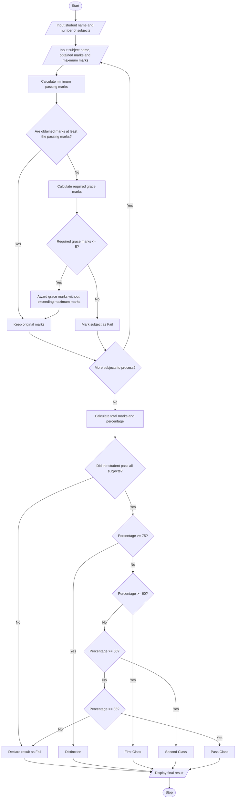

# Problem Statement
The Examination Result and Grace-Mark Validation system processes students' marks across multiple subjects. It checks whether each student meets the subject-wise passing criteria and applies a specified grace-mark policy when necessary. The system ensures that grace marks do not exceed the permitted limit and that the final marks of any subject never exceed its maximum marks. Finally, it determines whether the student has passed or failed and generates the final result classification based on the total percentage.
# Algorithm
1. Start the program.
2. Read the student's name and the number of subjects.
3. For each subject, input the subject name, obtained marks, and maximum marks.
4. Set the minimum passing marks for each subject.
5. Check whether the student has passed each subject.
6. If the student fails a subject, check whether grace marks can help the student pass.
7. Apply grace marks only if the required marks are within the permitted grace-mark limit.
8. Ensure that the final marks do not exceed the maximum marks of the subject.
9. Calculate the total obtained marks, maximum marks, and percentage.
10. If the student passes all subjects, assign a classification based on the percentage:
    - 75% and above: Distinction
    - 60% to below 75%: First Class
    - 50% to below 60%: Second Class
    - 35% to below 50%: Pass Class
11. If the student fails any subject, declare the result as Fail.
12. Display the subject-wise marks, grace marks awarded, total marks, percentage, and final result.
13. Stop the program.
Assumptions used in this program:
- Minimum passing marks are 35% of each subject's maximum marks, rounded up to the next whole number.
- The maximum grace marks are 5 per subject.
- Grace marks are awarded only when they are sufficient to help the student reach the passing marks.
- Grace marks cannot increase a subject's marks beyond its maximum marks.
- These rules are sample policies for this case study; actual examination rules may differ.
# Mermaid Flowchart

# sample input
EXAMINATION RESULT AND GRACE-MARK VALIDATION
--------------------------------------------------
Enter student name: Sailaja
Enter number of subjects: 3

Subject 1
Enter subject name: Mathematics
Enter maximum marks: 100
Enter obtained marks: 32

Subject 2
Enter subject name: English
Enter maximum marks: 100
Enter obtained marks: 68

Subject 3
Enter subject name: Physics
Enter maximum marks: 100
Enter obtained marks: 80
