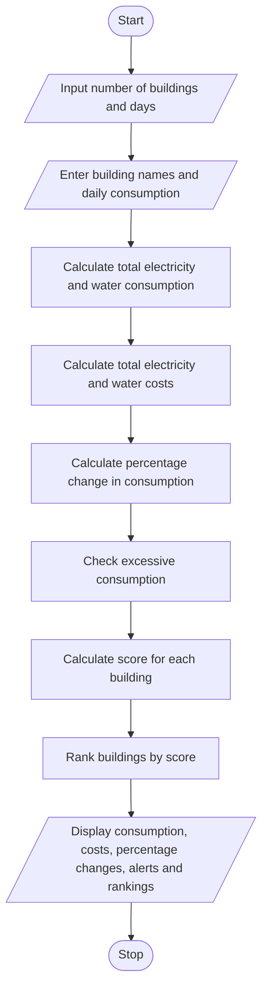

# Problem Statement
The Integrated Campus Energy and Water Audit system analyses electricity and water consumption across different campus buildings over multiple days. It calculates the total consumption cost, determines percentage changes in consumption, identifies buildings with excessive usage, and ranks buildings using a scoring method. The system helps college management monitor resource usage, reduce wastage, and improve energy and water efficiency.
# Algorithm
Step 1: Start the program.

Step 2: Input the number of campus buildings and the number of days.

Step 3: Enter the building names and daily electricity and water consumption values.

Step 4: Calculate the total electricity and water consumption for each building.

Step 5: Calculate the total cost using the electricity and water rates.

Step 6: Calculate the percentage change in consumption between the first and last days.

Step 7: Identify buildings with excessive consumption by comparing their average daily consumption with the specified threshold.

Step 8: Calculate a score for each building using the following formula:

Score = (Electricity Consumption × Electricity Rate) + (Water Consumption × Water Rate)

Step 9: Rank buildings in descending order of their scores.

Step 10: Display total consumption, costs, percentage changes, excessive consumption alerts, and building rankings.

Step 11: Stop the program.
# Mermaid Flowchart

# Sample Input
The program uses the following sample data:
Building	Electricity Consumption (kWh)	Water Consumption (litres)
Library	80, 90, 100	300, 320, 350
Laboratory	120, 140, 160	400, 450, 500
Hostel	150, 160, 180	600, 650, 700

Assumptions:
- Electricity rate = ₹8 per kWh.
- Water rate = ₹2 per litre.
- Excess electricity threshold = 100 kWh per day.
- Excess water threshold = 500 litres per day.
- Percentage change is calculated from the first day to the last day.
- The building with the highest total consumption cost receives the highest score and ranks first.
