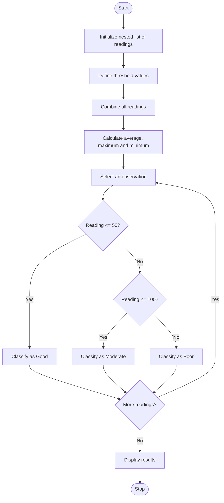

Environmental Monitoring Data Analyzer
#  Problem Statement
The Environmental Monitoring Data Analyzer is a Python-based application used to analyze environmental data, such as air-quality or water-quality readings. The system uses nested lists to store readings collected from different monitoring locations. It calculates the average, maximum, and minimum values of the readings and classifies each observation based on predefined threshold values. This helps identify pollution levels and supports environmental monitoring and protection.
#  Algorithm
1. Start the program.
2. Initialize a nested list containing environmental readings from different locations.
3. Define the threshold values for classifying observations.
4. Initialize an empty list to store all readings.
5. Traverse each nested list and extract individual readings.
6. Calculate the average, maximum, and minimum readings.
7. Classify each observation based on the threshold:
   - Good: Reading is less than or equal to 50.
   - Moderate: Reading is greater than 50 and less than or equal to 100.
   - Poor: Reading is greater than 100.
8. Display the readings, average, maximum, minimum, and classification of each observation.
9. Stop the program.
# Mermaid Flowchart

# Input
The program uses the following sample input, represented as a nested list.
readings = [    [35, 45, 55],    [65, 80, 95],    [110, 125, 40]]

# Threshold values:
- Good: Reading ≤ 50
- Moderate: 50 < Reading ≤ 100
- Poor: Reading > 100
The nested list represents readings from three monitoring locations, with three observations recorded at each location.
