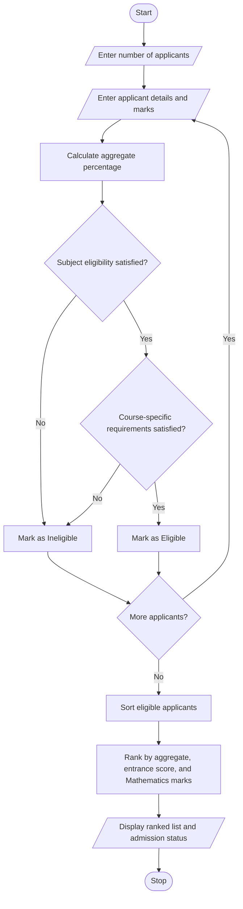

CASE STUDY: University Admission Decision Engine
# Problem Statement
The University Admission Decision Engine is a Python-based application designed to evaluate applicants for university admission. It checks subject eligibility, calculates aggregate marks, verifies course-specific minimum eligibility criteria, and ranks eligible applicants based on their performance.

The system uses aggregate marks as the primary ranking criterion. If two applicants have equal aggregate marks, it uses entrance examination scores as the first tie-breaker and subject marks as the second tie-breaker. Finally, it generates a ranked list of eligible applicants and displays their admission status.
# Algorithm
Step 1: Start the program.

Step 2: Enter the number of applicants.

Step 3: Enter each applicant's name, course, subject marks, and entrance examination score.

Step 4: Calculate the aggregate percentage using the following formula:
\[
\text{Aggregate Percentage}=\frac{\text{Total Subject Marks}}{\text{Maximum Total Marks}}\times100
\]
Step 5: Check whether the applicant satisfies the required subject eligibility criteria.

Step 6: Check whether the applicant meets the minimum aggregate percentage and course-specific admission requirements.

Step 7: If all eligibility conditions are satisfied, mark the applicant as eligible; otherwise, mark them as ineligible.

Step 8: Sort eligible applicants according to the following criteria:
1. Higher aggregate percentage.
2. Higher entrance examination score.
3. Higher Mathematics marks.
Step 9: Assign ranks to eligible applicants.

Step 10: Display the ranked list of eligible applicants and the status of ineligible applicants.

Step 11: Stop the program.
#  Mermaid Flowchart

# Sample Input
Enter number of applicants: 4

Enter details of applicant 1
Applicant name: Ravi
Course (CSE/ECE): CSE
Mathematics marks (out of 100): 90
Physics marks (out of 100): 85
Chemistry marks (out of 100): 80
Entrance examination score: 95

Enter details of applicant 2
Applicant name: Priya
Course (CSE/ECE): CSE
Mathematics marks (out of 100): 85
Physics marks (out of 100): 80
Chemistry marks (out of 100): 75
Entrance examination score: 90

Enter details of applicant 3
Applicant name: Arun
Course (CSE/ECE): ECE
Mathematics marks (out of 100): 70
Physics marks (out of 100): 65
Chemistry marks (out of 100): 60
Entrance examination score: 80

Enter details of applicant 4
Applicant name: Sita
Course (CSE/ECE): CSE
Mathematics marks (out of 100): 55
Physics marks (out of 100): 70
Chemistry marks (out of 100): 75
Entrance examination score: 85
