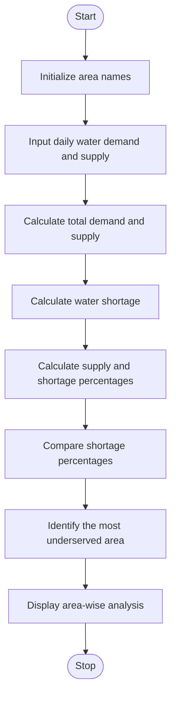

# Problem Statement
Water is an essential resource, and it must be distributed fairly among different areas. However, some areas may receive less water than their actual demand, resulting in shortages. The Water Distribution Fairness Analysis system analyses area-wise water demand and supply over several days, calculates water shortages and supply percentages, compares distribution levels, and identifies the most underserved areas. This analysis helps authorities improve water distribution and ensure fair access to water for all areas.
# Algorithm
1. Start the program.
2. Initialize the names of different areas.
3. Enter the daily water demand and actual water supply for each area.
4. Calculate the total demand and total supply for each area.
5. Calculate the water shortage using the formula:
   Water Shortage = Total Demand − Total Supply
6. Calculate the supply percentage using the formula:
   Supply Percentage = (Total Supply / Total Demand) × 100
7. Calculate the shortage percentage for each area.
8. Compare the shortage percentages of all areas.
9. Identify the area with the highest shortage percentage as the most underserved area.
10. Display the total demand, total supply, water shortage, and supply percentage for each area.
11. Stop the program.
# Mermaid Flowchart

# Sample Input
The program uses the following sample data for three days.
Area	Daily Demand (Litres)	Daily Supply (Litres)
Area A	1000, 1200, 1100	900, 1000, 950
Area B	1200, 1300, 1250	1000, 1100, 1000
Area C	800, 900, 850	750, 850, 800
Area D	1500, 1600, 1550	1000, 1050, 950
