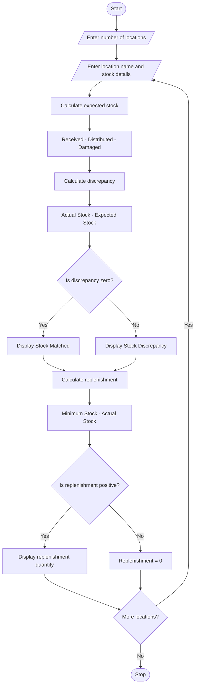

# Problem Statement
Food Supply Chain Stock Reconciliation is a system used to manage and monitor food stock across several locations. It compares the quantities of food received, distributed, damaged, and remaining at each location. The system identifies stock discrepancies by comparing the expected remaining quantity with the actual remaining quantity. It also calculates the replenishment quantity required to maintain sufficient stock and avoid food shortages.
#  Algorithm
Step 1: Start the program.

Step 2: Enter the number of locations.

Step 3: For each location, enter:
- Location name
- Quantity of food received
- Quantity of food distributed
- Quantity of food damaged
- Actual remaining stock
- Minimum stock required
Step 4: Calculate the expected remaining stock using the formula:

Expected Stock = Received − Distributed − Damaged

Step 5: Calculate the stock discrepancy:

Discrepancy = Actual Remaining Stock − Expected Stock

Step 6: If the discrepancy is zero, display "Stock Matched"; otherwise, display "Stock Discrepancy Found."

Step 7: Calculate the replenishment requirement:

Replenishment = Maximum (0, Minimum Stock Required − Actual Remaining Stock)

Step 8: Display the expected stock, actual stock, discrepancy, and replenishment quantity for each location.

Step 9: Stop the program.
# Mermaid Flowchart

# Sample Input
Enter number of locations: 2

Location 1
Enter location name: Warehouse
Enter quantity received: 1000
Enter quantity distributed: 600
Enter quantity damaged: 50
Enter actual remaining stock: 350
Enter minimum stock required: 500

Location 2
Enter location name: Canteen
Enter quantity received: 500
Enter quantity distributed: 300
Enter quantity damaged: 20
Enter actual remaining stock: 180
Enter minimum stock required: 250
