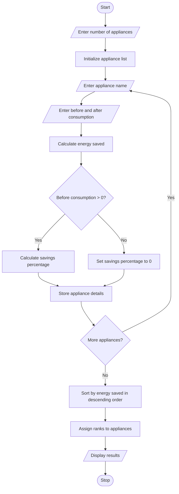

# Problem Statement
The Energy Conservation Before-and-After Analysis project compares appliance-wise electricity consumption before and after implementing energy conservation measures. The program calculates the electricity saved in kilowatt-hours (kWh), the savings percentage for each appliance, and ranks the appliances according to their achieved savings. This analysis helps identify which appliances contribute the most to energy conservation and encourages efficient electricity usage.
# Algorithm
1. Start the program.
2. Enter the number of electrical appliances.
3. For each appliance, input its name, electricity consumption before the intervention, and electricity consumption after the intervention.
4. Calculate the energy saved using:
   Energy Saved = Before Consumption − After Consumption
5. Calculate the savings percentage using:
   Savings Percentage = (Energy Saved / Before Consumption) × 100
   If the before-intervention consumption is zero, set the savings percentage to zero to avoid division by zero.
6. Store the appliance details, energy saved, and savings percentage.
7. Sort the appliances in descending order of energy saved to rank them.
8. Display the before-and-after consumption, energy saved, savings percentage, and rank of each appliance.
9. Stop the program.
# Mermaid Flowchart

# Sample Input
Enter the number of appliances: 4

Enter details for appliance 1
Appliance name: Fan
Electricity consumption before (kWh): 100
Electricity consumption after (kWh): 70

Enter details for appliance 2
Appliance name: Light
Electricity consumption before (kWh): 80
Electricity consumption after (kWh): 40

Enter details for appliance 3
Appliance name: AC
Electricity consumption before (kWh): 200
Electricity consumption after (kWh): 120

Enter details for appliance 4
Appliance name: Computer
Electricity consumption before (kWh): 150
Electricity consumption after (kWh): 90
