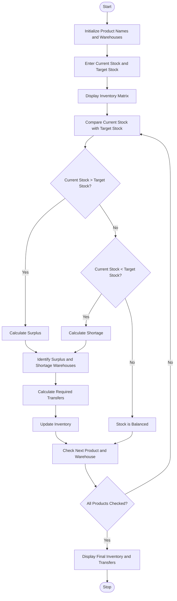

# Problem Statement
Inventory Matrix Reconciliation is used to compare product quantities across multiple warehouses using nested lists in Python. The program identifies shortages and surpluses by comparing the available stock with the target stock of each product. It also calculates the quantity of products that must be transferred between warehouses to meet the required stock targets efficiently.
# Algorithm
1. Start the program.
2. Initialize the product names, warehouse names, current stock quantities, and target stock quantities using nested lists.
3. Display the current inventory of each warehouse.
4. Compare the available stock with the target stock for each product in every warehouse.
5. If the available stock is greater than the target stock, calculate the surplus.
6. If the available stock is less than the target stock, calculate the shortage.
7. Identify warehouses with surplus stock and warehouses with shortages for each product.
8. Calculate the quantity to transfer from surplus warehouses to shortage warehouses.
9. Update the inventory quantities after transfers.
10. Display the shortages, surpluses, and required stock transfers.
11. Stop the program.
# Mermaid Flowchart

# Sample Input
The program uses the following inventory data.

Products: Laptop, Mobile, Tablet

Warehouses: Warehouse A, Warehouse B, Warehouse C
Current Stock Matrix
Warehouse	Laptop	Mobile	Tablet
Warehouse A	50	20	30
Warehouse B	15	40	25
Warehouse C	35	10	20

Target Stock Matrix
Warehouse	Laptop	Mobile	Tablet
Warehouse A	30	30	25
Warehouse B	25	30	25
Warehouse C	30	20	25
